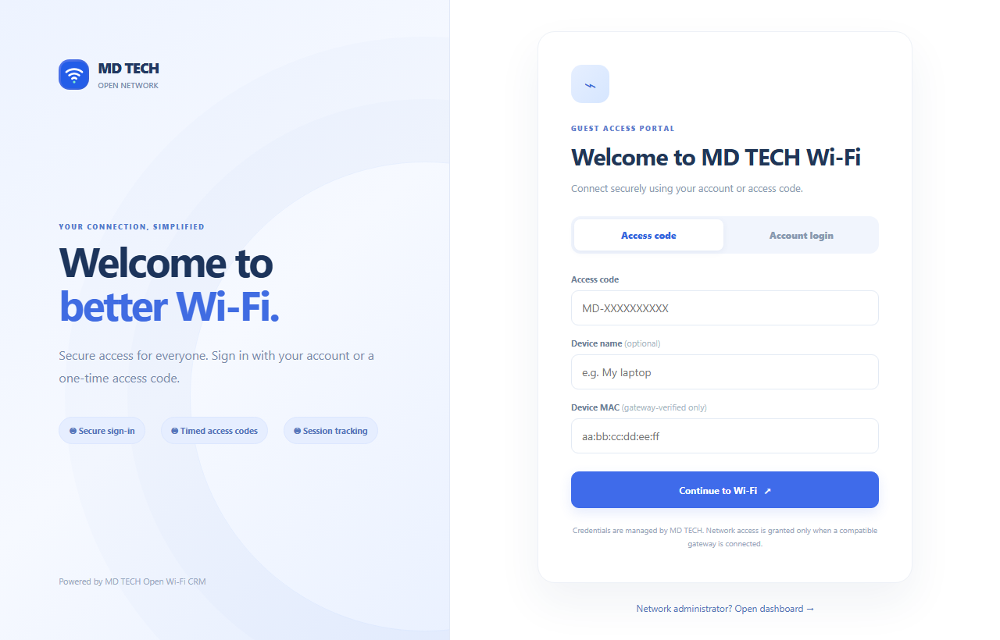
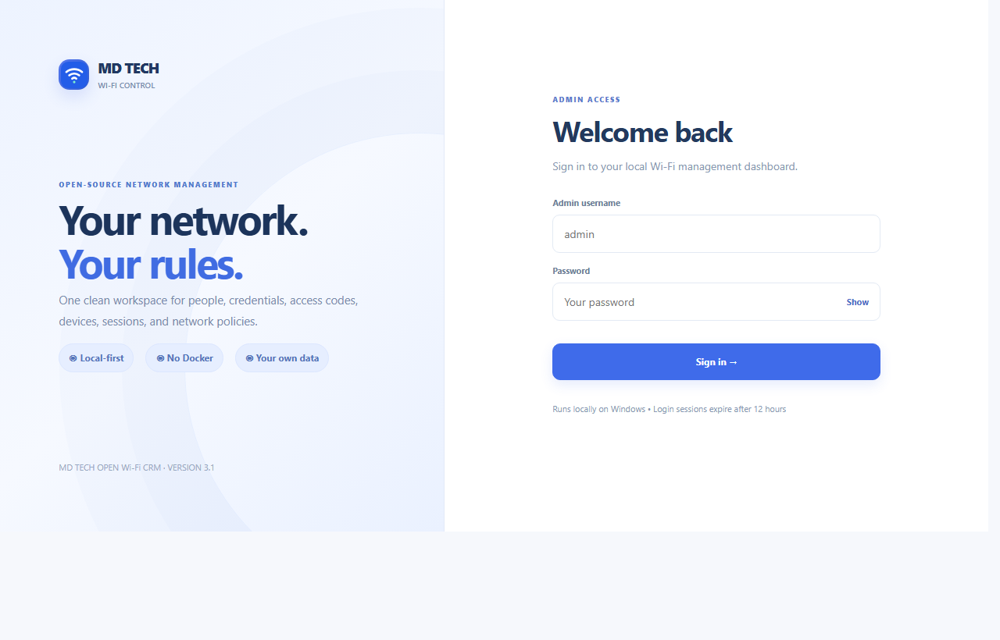
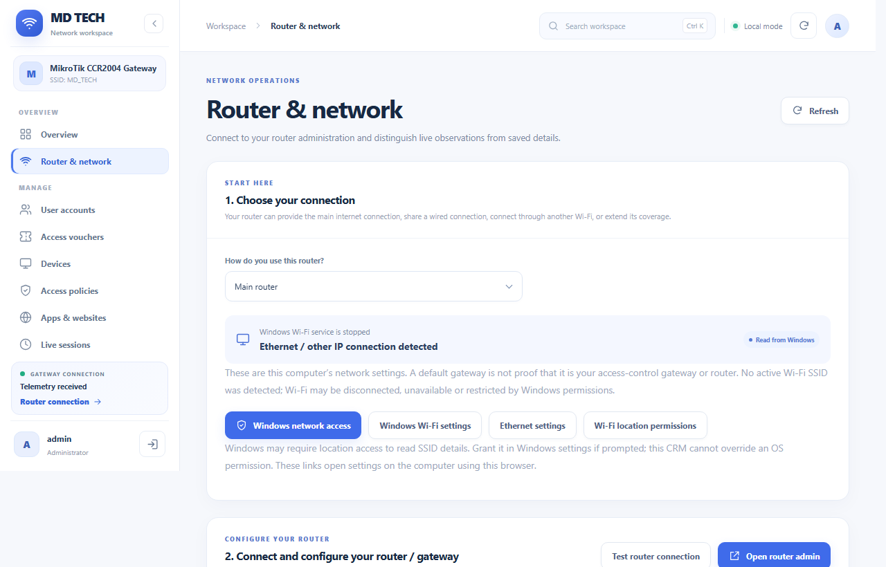
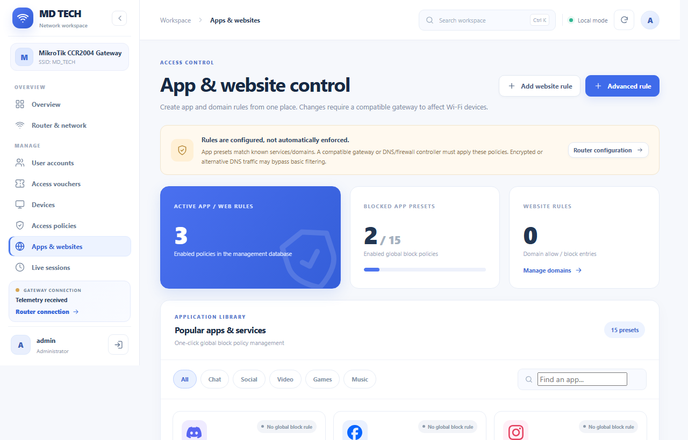

# MD TECH — Open Wi-Fi CRM & Captive Portal Management

[](https://github.com/md-tech-hacker/MD-TECH-WiFi-CRM-v3/actions)
[](https://www.python.org/)
[](LICENSE)
[]()
[](docker-compose.yml)
[](SECURITY.md)

**An open-source, local-first Wi-Fi account management system, voucher engine, policy decision controller, and gateway integration API.**

MD TECH Wi-Fi CRM provides a modern light-first web dashboard and guest portal to manage Wi-Fi visitors, issue cryptographically hashed time/quota-limited access vouchers, track device telemetry, enforce app and domain restrictions, and seamlessly connect to **any network gateway or router**.

---

## 📸 Interface Showcase

### Guest Login Portal (`/portal`)
*Clean, mobile-optimized guest login supporting one-time vouchers, user accounts, and automatic router redirection parameter detection (`mac`, `ip`, `authdir`, `link-login-only`).*



### Management Dashboard Overview (`/#/dashboard`)
*Live KPI cards, real 7-day reported traffic charts, recent device inventory, and quick-access navigation.*



### Universal Router & Network Studio (`/#/network`)
*Configure router profiles, check live Windows/Linux host interfaces, test management ports, and review tailored vendor deployment steps.*



### App & Website Policy Control (`/#/apps`)
*Filterable catalog of 15+ popular applications (YouTube, TikTok, Netflix, Spotify, Discord, etc.) with one-click block/allow rules and custom domain management.*



---

## 🌟 Key Capabilities

- **Universal Multi-Router Support**: Pre-configured profiles and reference adapters for **MikroTik RouterOS**, **OpenWrt (openNDS)**, **pfSense / OPNsense**, **Ubiquiti UniFi**, **TP-Link Omada**, and **Linux/Raspberry Pi** gateways.
- **Access Vouchers**: Batch generation of cryptographically secure random codes with duration limits, data quotas (MB), and usage limits. Codes are stored only as HMAC-SHA256 digests.
- **User Accounts**: Create and manage authenticated credentials for permanent guests, employees, or residents.
- **Deterministic Policy Engine**: Granular allow/block rules scoped globally, by user, or by device. Automatic port-stripping prevents domain block evasion.
- **Real-Time Device Inventory**: Hardware MAC tracking, custom friendly labels, active IP tracking, and true gateway-reported RX/TX byte accounting.
- **Zero Heavy Frontend Dependencies**: Bundled vanilla JavaScript and CSS; **no Node.js, npm, React, Webpack, or external CDNs required** to run.
- **Enterprise Security Hardening**:
  - Passwords hashed with `scrypt` (16,384 rounds).
  - Failed gateway authentication is IP rate-limited against brute-force attacks.
  - Cross-origin writes rejected with `Origin` and `Sec-Fetch-Site` verification.
  - Session cookies support strict `SameSite`, `HttpOnly`, and automatic `Secure` flags when running behind HTTPS reverse proxies.
  - CSV exports use formula sanitization to prevent spreadsheet execution attacks.

---

## 🚀 Quick Start Guide

### Option 1: Windows (One Click)
1. Install **Python 3.10 or newer** from [python.org](https://www.python.org/downloads/windows/).
2. Clone or extract the repository:
   ```cmd
   git clone https://github.com/md-tech-hacker/MD-TECH-WiFi-CRM-v3.git
   cd MD-TECH-WiFi-CRM-v3
   ```
3. Double-click **`START_WINDOWS.bat`**. It creates a private `.venv`, installs dependencies, and launches the server.
4. Open **http://127.0.0.1:8765** in your browser.
5. Create your administrator account on the setup screen.

### Option 2: Linux & macOS
```bash
git clone https://github.com/md-tech-hacker/MD-TECH-WiFi-CRM-v3.git
cd MD-TECH-WiFi-CRM-v3
chmod +x start_linux.sh
./start_linux.sh
```

### Option 3: Docker & Docker Compose
```bash
git clone https://github.com/md-tech-hacker/MD-TECH-WiFi-CRM-v3.git
cd MD-TECH-WiFi-CRM-v3
docker compose up -d
```
Open **http://localhost:8765** in your browser. Persistent database and encryption keys are saved to the `crm_data` volume.

---

## 📡 Network Architecture & Router Compatibility

The CRM functions as a **centralized AAA (Authentication, Authorization, Accounting) server and policy controller**. Network packet interception, captive redirection, and bandwidth enforcement are handled by your enforcement gateway:

```
+-----------------------------------------------------------+
|                     Internet / WAN                        |
+-----------------------------+-----------------------------+
                              |
                    [ Enforcement Gateway ]
         (MikroTik / OpenWrt / pfSense / Linux Gateway)
         - DHCP & DNS Server for Guests (e.g. 192.168.50.0/24)
         - Captive Portal Redirect & Walled Garden
                              |
         +--------------------+--------------------+
         | (Guest Network)                         | (Management LAN)
         v                                         v
   [Wi-Fi Access Points]                 [MD TECH Wi-Fi CRM Server]
  - UniFi, Omada, or Stock APs          - Runs on http://127.0.0.1:8765
  - Broadcasts SSID: MD_TECH              (or behind HTTPS reverse proxy)
  - AP Bridge Mode                      - Evaluates Policies & Issues Vouchers
         |
         v
   [Guest Devices]
   (Phones, Laptops, Tablets)
```

### Platform Compatibility Matrix:

| Platform | Capabilities | Integration Guide |
| :--- | :--- | :--- |
| **MikroTik RouterOS** (v6 / v7) | Native HotSpot, Walled Garden, Queues, REST API | Use [mikrotik_hotspot_sync.py](examples/mikrotik/mikrotik_hotspot_sync.py) daemon |
| **OpenWrt** | openNDS, uclient, CoovaChilli | Use [opennds_fas_server.py](examples/openwrt/opennds_fas_server.py) FAS adapter |
| **pfSense / OPNsense** | Captive Portal Zone, FreeRADIUS, Firewall Aliases | Point redirect to `/portal`; sync with API or RADIUS |
| **Ubiquiti UniFi** | External Guest Portal, Hotspot Manager | Set Controller External Portal URL to CRM `/portal` |
| **TP-Link Omada** | External Web Portal, Controller API | Configure External Portal Server in Omada Controller |
| **Linux / Raspberry Pi** | nftables, iptables, dnsmasq, hostapd | Run [nftables_captive_portal.sh](examples/linux_gateway/nftables_captive_portal.sh) |
| **Consumer APs** (TP-Link, ASUS) | Wi-Fi bridging | Run router in **AP mode** behind an enforcement gateway |

For complete hardware step-by-step instructions, see **[ROUTER_SETUP.md](ROUTER_SETUP.md)**.

---

## 🔒 Security Best Practices

1. **HTTPS in Production**: The server binds to `127.0.0.1` by default for local development. When deployed on a LAN or server, place it behind an HTTPS reverse proxy (e.g. Caddy, Traefik, or Nginx).
2. **Gateway Key Protection**: Generate a secret key under **Settings -> Gateway API Key**. Store this key on your router adapter; never distribute it to guest devices.
3. **Network Isolation**: Keep guest Wi-Fi on a dedicated VLAN or physical subnet (e.g. `192.168.50.0/24`), and block guests from accessing router management interfaces or the CRM administration panel.
4. Review **[SECURITY_REVIEW.md](SECURITY_REVIEW.md)** and **[SECURITY.md](SECURITY.md)** for detailed audits.

---

## 💻 Gateway REST API Reference

The CRM exposes a high-performance REST API for router adapters:

- **`POST /api/integrations/heartbeat`**: Send router telemetry, uptime, client counts, and capabilities every 30 seconds.
- **`POST /api/integrations/event`**: Report observed stations (`type: "device_seen"`) and bandwidth usage deltas (`type: "traffic"`).
- **`POST /api/integrations/authorize`**: Query whether a device request should be allowed or blocked based on active sessions, quotas, and policies.
- **`POST /api/integrations/bind`**: Cryptographically bind an authenticated guest login session to a station MAC address using the one-time `bind_token`.
- **`GET /api/integrations/state`**: Fetch active blocked MACs and revoked session IDs for firewall synchronization.

Interactive OpenAPI specifications are available at **http://127.0.0.1:8765/api/docs** when running.
Detailed contracts are documented in **[INTEGRATION.md](INTEGRATION.md)**.

---

## 🧪 Testing & Verification

Run the comprehensive Python test suite:
```bash
python -m pytest -v
```

Run the standalone frontend contract tests:
```bash
node tests/frontend_smoke.cjs
```

Regenerate documentation screenshots:
```bash
python scripts/capture_screenshots.py
```

---

## 🤝 Contributing

We welcome community adapters, router scripts, and feature contributions!
Please review **[CONTRIBUTING.md](CONTRIBUTING.md)** and follow the pull request workflow.

---

## 📄 License

This project is licensed under the [MIT License](LICENSE).
